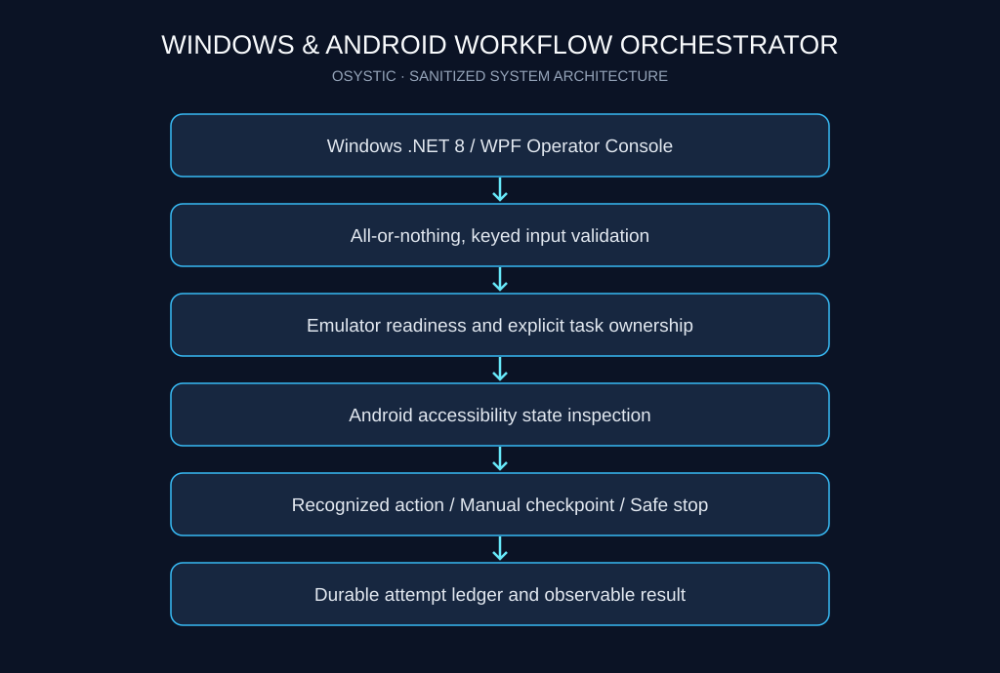

# Windows & Android Workflow Orchestrator — Engineering Case Study

> **PUBLIC SHOWCASE · SANITIZED · PORTFOLIO-SAFE**
>
> **OSYSTIC · Completed engineering delivery · Client-approved baseline**

An engineering case study on a Windows desktop control center combining defensive record import, Android emulator readiness, observable user-interface workflows and explicitly approved operations.

## Delivered scope

OSYSTIC engineered a C# / .NET 8 / WPF desktop application for supported Android emulator operations. The accepted implementation emphasizes exact record pairing, all-or-nothing input validation, selected task ownership, visible operator checkpoints, and replay-safe state management.

## Verified outcomes

| Validation layer | Result |
| --- | --- |
| Windows Release regression | **752/752 passed, 0 failures, 0 skipped** |
| Focused input and per-record tests | **40/40 passed** (subset of full regression) |
| Actual WPF desktop single-file import through both controls | **PASS**, synthetic records |
| Encrypted archive integrity | **275/275 decrypted entries PASS** |
| Frozen local source baseline | **276/276 SHA-256 files PASS** |
| Engineering delivery | **Completed and client-approved** |

**Proof boundary:** These results do not independently verify a successful third-party account submission, verification-code delivery or compatibility with every provider UI variant.

## Architecture

Windows WPF operator console → strict import validation → Pending task store → LDPlayer/ADB preflight → exact record-to-instance assignment → Android UI accessibility inspection → verified action, manual checkpoint or safe stop → durable one-time attempt ledger.

## Public vs. private repository boundary

| Public showcase | Confidential engineering implementation |
| --- | --- |
| Sanitized architecture and learning outcomes | Source code, WPF application and test implementation |
| High-level validation evidence | Client-delivery source and internal configuration |
| Public-safe SVG diagrams | Controlled synthetic UI acceptance records |
| No client identifiers or secrets | Access-restricted delivery materials |

The proprietary implementation is not distributed or licensed via this repository.

## Technology

C# · .NET 8 · WPF · Windows x64 · LDPlayer · ADB · Android accessibility · JSON · xUnit · GitHub Actions

## Documentation

- [Full case study](case-study.md)
- [Technical overview](docs/technical-overview.md)
- [Validation evidence](docs/validation-evidence.md)
- [Engineering lessons](docs/lessons-learned.md)
- [Disclosure boundary](docs/disclosure-boundary.md)

© **OSYSTIC**. All rights reserved.
