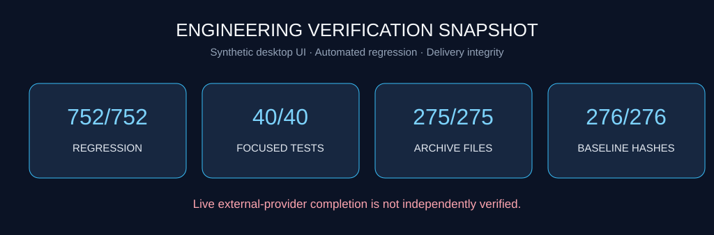

# Validation Evidence

| Check | Verified result |
| --- | --- |
| Windows .NET Release tests | 752 passed, 0 failed, 0 skipped |
| Focused importer/per-record tests | 40 passed (included in 752) |
| WPF one-file import through both controls | PASS, synthetic |
| No implicit task execution after import | PASS |
| Encrypted release integrity | 275/275 files decrypted and checked |
| Frozen source workspace | 276/276 file hashes matched |

These represent the approved engineering delivery. They do **not** prove live third-party service registration, SMS receipt, security challenge handling, or provider-end acceptance.

Private implementation, exact test fixtures and runtime materials are withheld; public reproduction of proprietary source tests is not claimed.
